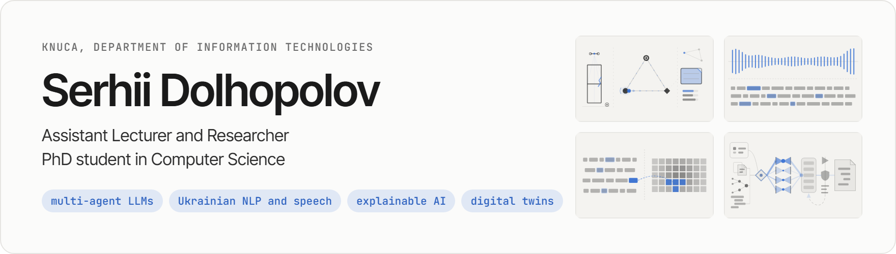

<picture>
  <source media="(prefers-color-scheme: dark)" srcset="https://raw.githubusercontent.com/F1-bot/F1-bot/main/assets/banner-dark.png">
  
</picture>

  
  
  
  
  
  
  
  
   
  
  

I am an Assistant Lecturer and Researcher at the Department of Information Technologies of Kyiv National University of Construction and Architecture (KNUCA), Kyiv, Ukraine. I am also a PhD student in Computer Science there, advised by Prof. Tetyana Honcharenko.

My work covers multi-agent LLM systems, NLP and speech technology for the low-resource Ukrainian language, multimodal sentiment analysis with explainable AI, computer vision and BIM-driven digital twins for construction, and graph and sequence models for environmental forecasting.

Since 2023 I have been an accreditation expert of the National Agency for Higher Education Quality Assurance (NAQA). I hold an MSc in Cyber Security (2023) and a BSc in Vocational Education (Computer Technologies, 2022) from KNUCA, both with honours.

## Projects

<table>
<tr>
<td width="33%" valign="top">

 <b>AI-Agent-Based Digital Twins for Damaged Infrastructure</b>
 Project leader, Ministry of Education and Science of Ukraine, No. 0126U001450, 2026–2028
  AI agents check BIM/IFC digital twins of damaged infrastructure against photogrammetry and LiDAR data and update the models. <a href="https://doi.org/10.1109/SIST61674.2026.11596258">SIST 2026 paper</a>
</td>
<td width="33%" valign="top">

 <b>BUDOVA: Ukrainian Open Voice and Text Archives</b>
 Principal investigator, Microsoft Research LINGUA Open Call, 2026–2027
  The project builds an open corpus of Ukrainian construction speech and technical text with NER annotations and a baseline ASR model. All of it will be released under CC BY 4.0. <a href="https://budov.org">budov.org</a>
</td>
<td width="33%" valign="top">

 <b>Multimodal Content Tonality for Territorial Revitalization</b>
 Team member, Ministry of Education and Science of Ukraine, No. 0125U001683, 2025–2027
  Neural-network and explainable-AI methods classify text, images and metadata from revitalization projects. The project is led by Prof. Tetyana Honcharenko.
</td>
</tr>
</table>

## Teaching

These labs belong to my course *Applied AI and MLOps in the Software Development Process*. The instructions are in Ukrainian, and five of the six labs run without API keys.

<table>
<tr>
<td width="33%" valign="top">

 <code>LAB 1</code>
 <a href="https://github.com/F1-bot/smolagent_sample"><b>smolagent_sample</b></a>
 Students build an assistant with long-term RAG memory on smolagents and FAISS, with a local model in Ollama.
</td>
<td width="33%" valign="top">

 <code>LAB 2</code>
 <a href="https://github.com/F1-bot/llamaindex_sample"><b>llamaindex_sample</b></a>
 Agents on LlamaIndex call tools and run on a local model in Ollama.
</td>
<td width="33%" valign="top">

 <code>LAB 3</code>
 <a href="https://github.com/F1-bot/langchain_sample"><b>langchain_sample</b></a>
 A FastAPI backend with LangChain, Gemini and Tavily answers questions about construction documents.
</td>
</tr>
<tr>
<td width="33%" valign="top">

 <code>LAB 4</code>
 <a href="https://github.com/F1-bot/mcp_sample"><b>mcp_sample</b></a>
 Students write an MCP server over SQLite with tools, resources and prompts.
</td>
<td width="33%" valign="top">

 <code>LAB 5</code>
 <a href="https://github.com/F1-bot/opencode_lab5"><b>opencode_lab5</b></a>
 A coding agent (OpenCode) fixes a broken project while tests and permission rules check its work.
</td>
<td width="33%" valign="top">

 <code>LAB 6</code>
 <a href="https://github.com/F1-bot/observability_lab6"><b>observability_lab6</b></a>
 OpenTelemetry traces an LLM agent, and Phoenix and Jaeger show its cost, latency and failures.
</td>
</tr>
</table>

I also teach Modelling of AI Tasks, Programming in Python, Object-Oriented Programming, Neural Networks and AI Systems in Education, and AI and Hybrid Networks. Prof. Honcharenko and I wrote the study guide *Modelling of AI Tasks (Part 1)* (KNUCA, 2025, 546 pages). It took first place in the textbooks category of the “Best Publication of 2025” competition of the National Academy of Sciences of Higher Education of Ukraine.

## Selected publications

<table>
<tr>
<td width="184" valign="top"></td>
<td valign="top"><a href="https://doi.org/10.1109/SIST61674.2026.11596258">Agentic AI-Driven Architecture for Dynamic Verification of Infrastructure Digital Twins</a>
 <b>S. Dolhopolov</b>, T. Honcharenko, Y. Dudnyk, V. Hots, A. Fesan, N. Batyr
 IEEE SIST 2026, 6th International Conference on Smart Information Systems and Technologies</td>
</tr>
<tr>
<td width="184" valign="top"></td>
<td valign="top"><a href="https://ceur-ws.org/Vol-4220/paper17.pdf">MACE: Modular Adaptive Code Engine with Context-Aware LoRA Expert Routing and Hierarchical Retrieval-Augmented Generation</a>
 <b>S. Dolhopolov</b>, T. Honcharenko
 CMIS 2026, 9th International Workshop on Computer Modeling and Intelligent Systems, CEUR-WS Vol. 4220</td>
</tr>
<tr>
<td width="184" valign="top"></td>
<td valign="top"><a href="https://doi.org/10.3390/w18162055">Explainable Deep Ensemble Bias Correction of GloFAS-ERA5 Streamflow Across Snow-Influenced Transboundary Basins of Central Asia</a>
 T. Honcharenko, <b>S. Dolhopolov</b>, A. Neftissov, I. Kazambayev, A. Aubakirova, L. Kirichenko, O. Kuchanskyi
 Water (MDPI) 18(16), 2026, Q1. <a href="https://github.com/F1-bot/Explainable_Deep-Ensemble_Bias_Correction_of_GloFAS-ERA5">Code</a>, <a href="https://zenodo.org/records/21325905">Zenodo</a></td>
</tr>
<tr>
<td width="184" valign="top"></td>
<td valign="top"><a href="https://doi.org/10.32620/reks.2025.4.07">Explainable Artificial Intelligence for Multimodal Sentiment Analysis in Revitalization Project Management</a>
 <b>S. Dolhopolov</b>, Y. Riabchun, M. Delembovskyi, O. Molodid
 Radioelectronic and Computer Systems, 2025, no. 4. <a href="https://github.com/F1-bot/revitalization-msa-xai">Code</a></td>
</tr>
<tr>
<td width="184" valign="top"></td>
<td valign="top"><a href="https://doi.org/10.3390/w17142097">An Advanced Ensemble Machine Learning Framework for Estimating Long-Term Average Discharge at Hydrological Stations Using Global Metadata</a>
 A. Neftissov, A. Biloshchytskyi, I. Kazambayev, <b>S. Dolhopolov</b>, T. Honcharenko
 Water (MDPI) 17(14), 2025, Q1. <a href="https://github.com/F1-bot/lta-discharge-ensemble-ml">Code</a></td>
</tr>
<tr>
<td width="184" valign="top"></td>
<td valign="top"><a href="https://doi.org/10.1109/SIST61657.2025.11139225">Sensor-Aware Graph Convolutional and LSTM Model for Reliable Water Quality Forecasting</a>
 <b>S. Dolhopolov</b>, V. Hots, O. Fedusenko, A. Fesan
 IEEE SIST 2025, 5th International Conference on Smart Information Systems and Technologies</td>
</tr>
<tr>
<td width="184" valign="top"></td>
<td valign="top"><a href="https://ceur-ws.org/Vol-3966/W3Paper10.pdf">Advancing Automated Quality Control in Automotive Manufacturing: A Comparative Analysis of YOLOv8, YOLOv9, and YOLOv10 for Vehicle Damage Detection</a>
 <b>S. Dolhopolov</b>, T. Honcharenko, D. Chernyshev, O. Panina, A. Makhynia
 DTESI 2024, CEUR-WS Vol. 3966. Best Paper Award</td>
</tr>
<tr>
<td width="184" valign="top"></td>
<td valign="top"><a href="https://doi.org/10.23919/fruct61870.2024.10516383">Multi-Stage Classification of Construction Site Modeling Objects Using Artificial Intelligence Based on BIM Technology</a>
 <b>S. Dolhopolov</b>, T. Honcharenko, O. Terentyev, V. Savenko, A. Rosynskyi, N. Bodnar, E. Alzidi
 FRUCT 2024, 35th Conference of Open Innovations Association</td>
</tr>
</table>

Submitted: *From Access Control to AI Trustworthiness: Extending Graded Security Evaluation Criteria with a Certifiable Service Class and Probabilistic Conformity Semantics*, Journal of Cybersecurity and Privacy. [Code and data](https://github.com/F1-bot/From-Access-Control-to-AI-Trustworthiness)

The code of two more papers is also here. [appendix_STUE_2026](https://github.com/F1-bot/appendix_STUE_2026) goes with *Fusing Grad-CAM and Textual Explainable AI for Urban Sentiment Assessment* (STUE-2025, Kharkiv), and [multi-label-text-classification-for-professional-orientation](https://github.com/F1-bot/multi-label-text-classification-for-professional-orientation) goes with [*Use of Artificial Intelligence Systems for Determining the Career Guidance of Future University Student*](https://doi.org/10.1109/SIST54437.2022.9945752) (IEEE SIST 2022).

All 25 papers are listed on [Google Scholar](https://scholar.google.com/citations?user=I54c3uQAAAAJ&hl=en) and on [my website](https://f1-bot.github.io/).

## Awards and certificates

<table>
<tr>
<td width="50%" valign="top">
<b>Awards</b>
<ul>
<li>Scholarship of the President of Ukraine for PhD students, 2026–2027</li>
<li>Letter of Gratitude, Ministry of Education and Science of Ukraine, 2026</li>
<li>1st place, CTF 2026 UA-EE Cyber Shield (Tallinn Mechanism), team Heart-Shaped Box</li>
<li>1st place, Zavtra.UA essay competition, Victor Pinchuk Foundation, 2025</li>
<li>Zavtra.UA scholarship of the Victor Pinchuk Foundation, awarded twice</li>
<li>Verkhovna Rada of Ukraine scholarship, awarded twice</li>
</ul>
</td>
<td width="50%" valign="top">
<b>Certificates</b>
<ul>
<li>AMD ROCm Certified Associate, 2026</li>
<li><a href="https://edu.google.accredible.com/38fbb280-cd0a-4e92-a69f-7060ec0e8030">Gemini Certified Educator</a>, Google for Education, 2025</li>
<li>NASA Open Science 101</li>
<li>Set Up and Configure a Cloud Environment in Google Cloud, Engineer Data in Google Cloud and Share Data Using Google Data Cloud</li>
<li>AI and Digital Transformation in Government</li>
</ul>
</td>
</tr>
</table>

## Tools

  
  
  
  
  
  
  
  
  
  
  
  

I also work with smolagents, LlamaIndex, PEFT and TRL, LoRA and QLoRA fine-tuning, vLLM, llama.cpp, SHAP, Grad-CAM and Captum.
